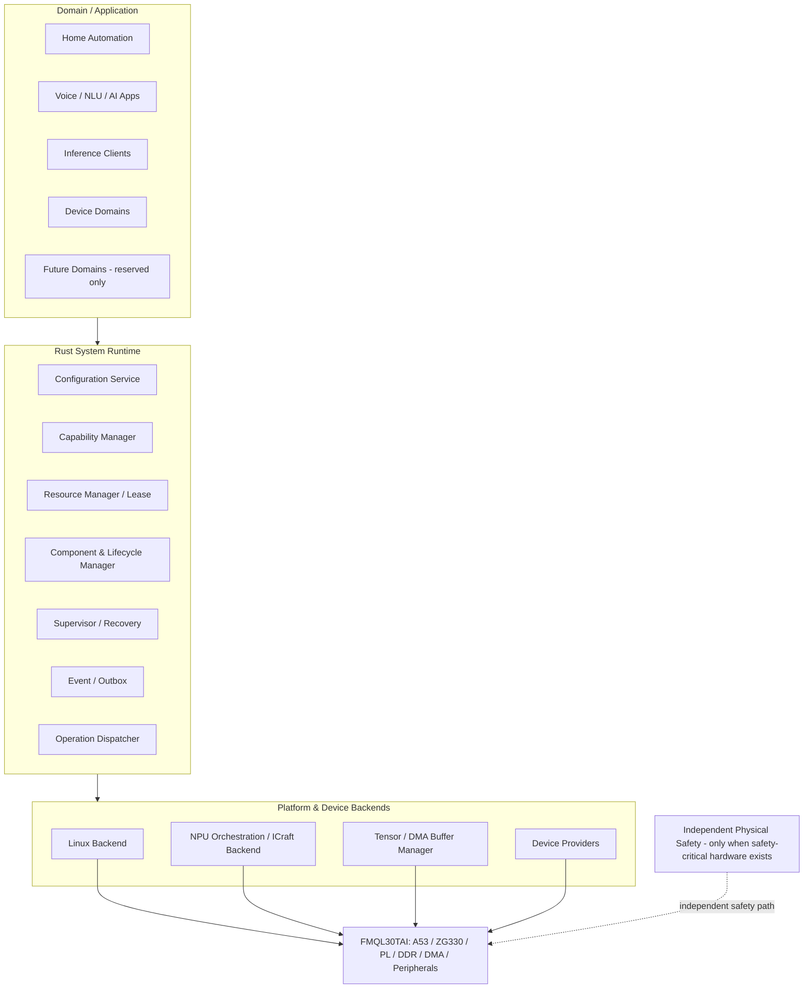

# 01 — 目标架构与边界

## 1.1 总体目标

构建以 Rust 为主要系统管理语言的异构智能家居系统：在 FMQL30TAI 上协调 Cortex-A53、ZG330 NPU、FPGA PL、PS/PL DDR、DMA 与物理设备；具备组件生命周期、资源所有权、权限控制、故障监督、配置管理和异构推理能力。

初期使用厂商 Linux 5.4.52 与 ICraft 3.39.0。系统自研重点放在 Linux/ICraft 未提供的**系统级协调层**，而非重新实现 Linux 调度器、ONNX 编译器或 NPU Runtime。

## 1.2 明确范围

### 当前范围

- Rust System Runtime：Resource Manager、Capability、Component/Lifecycle、Supervisor/Recovery。
- Configuration Service：Namespace、Schema、Revision、Desired/Applied、Provider。
- Inference Manager：CPU/NPU 后端、NPU 单 Owner 编排、Tensor/Buffer 所有权。
- Device Core：通用设备描述、生命周期、Lease、Operation、Telemetry、Fault。
- Linux Backend：使用当前内核真正可用的进程、RLIMIT、调度、设备节点和 DMA 接口。
- 测试与部署：x86 开发、AArch64 交叉编译、FMQL30TAI 实机验收。

### 当前不做

- 不开发机械臂控制器、ROS 2 节点、MoveIt 配置、Gazebo/MuJoCo 仿真。
- 不直接 Fork rustc。
- 不重写 Linux 内存管理、文件系统、网络栈和线程上下文切换。
- 不开发 ONNX Compiler 或替换 ICraft Runtime。
- 不假定 cgroups v2、Namespace、seccomp、LSM 或 IOMMU 在当前板端可用。

### 未来预留

未来机器人/车辆/工业设备通过 Device Provider、Operation、Resource Lease、Execution Contract、Telemetry、Fault 等通用接口接入。具体领域类型和控制闭环留在独立 Domain，不放进 OS 核心。

## 1.3 总体架构

## 1.4 架构职责

| 层 | 负责 | 不负责 |
|---|---|---|
| Domain | 业务语义、设备专属命令、策略 | Linux PID、裸 DMA 地址、全局内核配置 |
| System Runtime | 资源准入、权限、配置、生命周期、故障协调 | 具体 NPU 算子实现、机器人运动学 |
| Backend | 把系统抽象映射到 Linux/ICraft/设备 SDK | 决定跨领域业务优先级 |
| Linux Kernel | 当前实际可用的进程、线程、MMU、调度、DMA/驱动机制 | 当前未编译的隔离机制 |
| Hardware/firmware | NPU、PL、驱动器内部执行；未来可能承担独立安全反应 | 用户业务配置策略 |

## 1.5 统一管理而非统一实现

统一的是身份、权限、资源合同、生命周期和错误语义；不强求所有执行后端使用同一个算法或队列：

- CPU：Linux Scheduler 当前执行。
- NPU：Rust Orchestration 负责系统级排队/准入，ICraft 负责 NPU 内部执行。
- PL：按实际硬件 Pipeline/任务接口管理。
- 设备：通过 Lease/独占/共享策略管理。
- 未来 RT 控制：由独立实时执行域负责，不经过普通业务 Work Queue。

## 1.6 核心对象边界

| 对象 | 含义 |
|---|---|
| Durable Task | 需要持久化、重启恢复的业务任务 |
| Event | 已发生的事实及其序号 |
| Command | 请求执行某项业务/设备操作 |
| Operation | 可异步跟踪的操作实例，具备状态、取消和结果语义 |
| Work Item | 已就绪、等待某个执行后端处理的工作 |
| Execution Context | 实际执行工作的线程、进程或设备执行上下文 |
| Resource Lease | 对设备、Buffer、Session 等资源的临时所有权 |
| Execution Contract | 执行时间、预算、内存和后端要求 |

不要将 `tasks.py` 的持久任务直接称为 CPU Scheduler；也不要把 NPU Job、设备 Lease 和 CPU Thread 混成一种调度对象。

## 1.7 设计原则

1. 现有代码是资产与事实来源，不是必须保留的结构。
2. 先由真实负载推导抽象，避免空泛的“万能平台接口”。
3. 控制面与数据面分离；大块数据不经 JSON/HTTP 反复序列化。
4. 内存/设备地址必须带类型和地址域，禁止混用裸 `u64`。
5. 权限检查与最终强制执行分开描述；用户态授权不能冒充内核强制隔离。
6. 故障恢复不等于设备安全恢复；硬件挂死和物理安全路径必须单独处理。
7. 所有性能结论用目标板测量，不以 x86 数值替代 A53。
