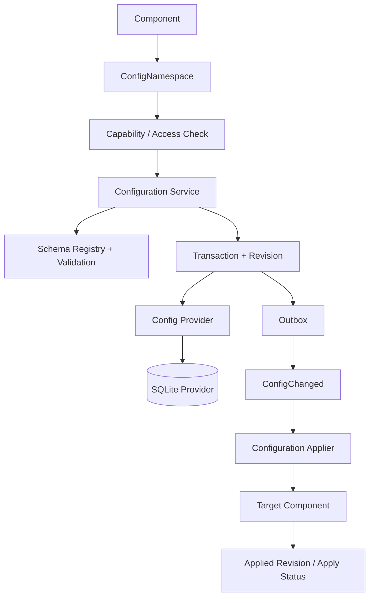

# 04 — Configuration Service

## 4.1 定位

Configuration Service 是跨 Domain 的系统服务，不属于 Home、Voice 或 Inference 某个业务域。组件通过 ConfigNamespace 访问配置；服务统一执行权限、Schema、Revision、事务、事件和 Desired/Applied 协调。

## 4.2 架构



## 4.3 Namespace

建议路径：

```text
system/{runtime,resources,security,logging}
services/{voice/{asr,vad,kws,tts},nlu,executor,inference}
devices/{provider}/{device-id}
domains/{home,...}
```

未来可以有 `domains/robotics`，但现在不实现机器人专属配置 Schema。

Namespace 是逻辑访问范围，不要求与磁盘目录对应。路径必须规范化并拒绝 `..`、空段、非法分隔符和路径逃逸。子 Namespace 权限不得自动扩大父 Namespace 授予范围。

## 4.4 Access / ReadOnly

支持 `Read`、`Write`、`ReadWrite`、`Admin`。`read_only()` 是 API 封装，不能单独形成安全边界；当前板端需要通过进程身份、文件权限和唯一 Provider 服务限制绕过。之后可映射到内核强制机制。

## 4.5 ConfigValue

第一版建议：

```rust
#[derive(Clone, Debug, Serialize, Deserialize)]
enum ConfigValue {
    Bool(bool),
    Integer(i64),
    Float(f64),
    String(String),
    Bytes(Vec<u8>),
    StringList(Vec<String>),
}
```

规则：Float 拒绝 NaN/Infinity；Bytes 只用于小型配置数据；模型/固件/图片等大型资产用独立 Asset/Blob 存储；JSON Schema 表达 Bytes 时采用明确编码格式。

## 4.6 Schema

- 组件声明自己的 Schema 和默认值。
- Configuration Service 负责注册、验证和版本兼容。
- 不让系统配置服务理解 `vad_threshold` 等业务语义。
- 为 Schema 保留 `schema_version` 和迁移入口。

候选复用：Schemars 生成 JSON Schema；jsonschema 做运行时验证。最终版本需经过 ARM64 构建和板上测试，不能先固定最新版。

## 4.7 Provider API

概念接口：

```rust
trait ConfigProvider {
    fn get(&self, namespace: &str, key: &str)
        -> Result<Option<VersionedConfigValue>, ConfigError>;
    fn list(&self, namespace: &str) -> Result<Vec<String>, ConfigError>;
    fn commit(&self, tx: ConfigTransaction)
        -> Result<ConfigCommitResult, ConfigError>;
}
```

Namespace API：`get`、`get_typed`、`list`、`child`、`read_only`、`read_write`、`transaction`、`subscribe`。

Provider 只负责数据存取；Configuration Service 做授权、Schema、Revision 和事件；Applier 负责生效协调。

## 4.8 Transaction / Revision / Outbox

配置修改需要原子性：

```text
BEGIN
  validate values
  check expected_revision
  write config rows
  increment namespace revision
  insert ConfigChanged into outbox
COMMIT
publish outbox event
apply on target service
record applied_revision + status
```

发布事件必须在事务提交之后；可靠事件由 Outbox 负责，Tokio broadcast/watch 只用于进程内通知，不作为持久事件来源。

错误应可区分：NamespaceNotFound、KeyNotFound、TypeMismatch、PermissionDenied、ValidationFailed、Conflict/RevisionMismatch、ProviderUnavailable、SerializationError、ResourceExhausted。

## 4.9 Desired / Applied / Observed

- Desired：持久化配置目标版本。
- Applied：服务已成功应用的版本。
- Observed：服务报告的运行时实际状态。

配置写入成功不等于服务已应用。失败时保留 desired/applied 差异，报告失败原因，不伪造成功。

## 4.10 Secret

密码、Token、设备密钥单独通过 Secret Handle/Provider 管理，权限收紧、日志脱敏、加密存储。`secrecy`/`zeroize` 只提供类型和内存处理辅助，不自动实现安全密钥存储。

## 4.11 生命周期

Rust RAII 管理 Connection、Transaction、文件句柄、锁和临时对象。Drop 适合同步释放/回滚，不承担异步远程关闭、设备 reset 或耗时恢复。

## 4.12 可复用 crate 候选

| 能力 | 候选 | 说明 |
|---|---|---|
| 序列化 | serde | 直接复用 |
| 动态值 | serde_json | 受限中间表示；Bytes 需编码约定 |
| Schema 生成 | schemars | 候选 |
| Schema 验证 | jsonschema | 候选，核对 Schema Draft 和 MSRV |
| SQLite | rusqlite | 候选；事务与阻塞线程边界自定 |
| 错误派生 | thiserror | 直接复用 |
| 异步通知 | tokio::sync | watch/broadcast/mpsc 语义按场景选 |
| Secret 类型 | secrecy + zeroize | 不代替加密存储 |
| 内存快照 | arc-swap | 只有高频读/低频写且测得锁竞争后采用 |
| 文件变更 | notify | 只有文件 Provider 需要时采用 |
| 启动配置加载 | figment 或 config 二选一 | 不取代动态配置服务 |

## 4.13 配置服务验收

- [ ] Namespace 路径规范化和越权测试。
- [ ] ReadOnly/ReadWrite/Capability 权限测试。
- [ ] Schema 类型、范围、默认值、未知字段测试。
- [ ] expected_revision 冲突测试。
- [ ] 批量写入原子性测试。
- [ ] Outbox 与配置提交一致性测试。
- [ ] Applier 失败时 Desired/Applied 状态正确。
- [ ] Provider 不可用和 SQLite 锁竞争测试。
- [ ] 敏感值不进入日志/事件。
- [ ] x86 与 AArch64 结果一致，板上 RSS/延迟合格。
