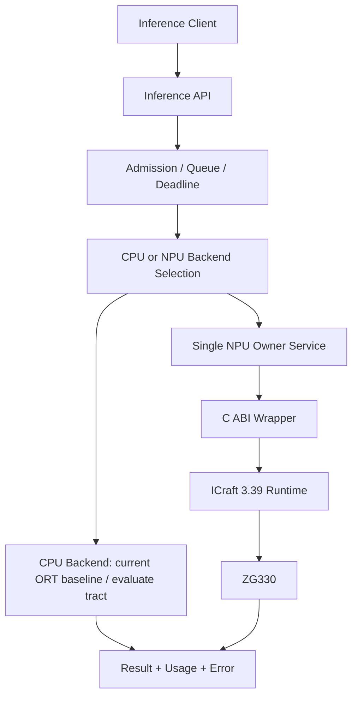

# 05 — 异构推理与 ZG330 / ICraft

## 5.1 目标

以 Rust Inference Manager 提供统一模型接口，协调 A53 CPU、ZG330 NPU 和必要的 PL 加速。复用 ICraft 编译器与 Runtime，不重写 NPU 内部执行系统。

## 5.2 当前 ICraft 能力边界（3.39.0）

- [FACT-A/B] CLI/板端 Runtime 版本 3.39.0（CLI build `3.39.0.0-431be90`）。
- [FACT-B] 正式 API 包含 Session、Device、Tensor、Backend、MemRegion、MemManager 等。
- [FACT-A/B] 当前调查未发现 ICraft 系统级 Scheduler。
- [FACT-A/B] `forward` 同步阻塞；未发现 cancel/abort API。
- [FACT-B] Server 文档不建议同时打开多个 Server。
- [FACT-C] `FForwardBackend` 中有 `priority` 参数但语义未解释，不能当作已验证的任务优先级接口。
- [FACT-B] `Device::reset(level)` 存在，但 ZG330 等级语义未获厂商确认。

因此系统级排队、准入、多模型分时、调用方公平性和恢复策略属于我方 Orchestration Layer。

## 5.3 数据流



默认策略：一个受控 NPU Owner 管理设备生命周期和调用队列；普通应用不直接打开多个 ICraft Server。是否能在同一 Backend 内安全并发，需要独立证据，不从 demo 推导通用保证。

## 5.4 NPU Orchestration

职责：

- 请求队列和准入。
- 模型/Session 生命周期。
- 请求 Deadline/Timeout 管理。
- Buffer 生命周期与访问所有权。
- Backend 使用统计。
- 错误分类和恢复等级。
- 对上层报告 `accepted/queued/running/completed/failed/unknown`。

由于 ICraft `forward` 同步阻塞且没有已确认取消接口：

- 排队中的请求可以取消。
- 已进入 `forward` 的请求不能承诺及时取消。
- 超时返回不代表 NPU 硬件已停止访问 Buffer。
- 未确认任务结束前不能释放设备仍可能访问的 Buffer。
- NPU 严重挂死当前可能需要断电；不得自动把进程重启或 `Device::reset` 当成可恢复方案。

## 5.5 FFI 边界

```text
Rust API → safe wrapper → C ABI → C++ ICraft → ZG330
```

C ABI wrapper 使用 opaque handles、固定宽度整数、显式错误码、明确 Buffer ownership。所有 C++ exception 必须在 C++ 边界 catch 并转换为错误码；禁止异常跨 C ABI。`unsafe` 集中在少量 FFI/Buffer 模块。

## 5.6 CPU Backend

先建立当前 ORT/FunASR ONNX 运行路径作为 A53 基线，再评估 tract：

- 目标模型算子和 Shape 覆盖。
- RSS/峰值内存。
- 模型加载时间、首次推理、稳态 P50/P95。
- 单线程/多线程 CPU 占用。
- 数值结果一致性。
- ARM64 构建与部署复杂度。

不能因为 tract 是 Rust 实现就直接选它；也不能只因为 ORT 已在跑就排除 tract。

## 5.7 精度与模型能力

当前调查记录：`qdtype` 包含 int8/bf16/fp16/tf32；无 int4；30TAI 不再支持 int16；当前不支持 asymmetric。ONNX 入口 opset 17。`Where` 在 ZG 侧落 Host，`Gather` 有定义但下降实现不完整，`RopeDynamic` 仅 Host；RMSNorm 未在所查规格中找到。模型表存在不支持算子黑名单。

必须建立 `Operator × DType × Shape × CompilerVersion × RuntimeVersion` 能力矩阵。芯片支持精度不等于每个算子/模型都支持。

## 5.8 整模型选择优先，子图混合后置

第一阶段：同一模型分别准备 CPU/NPU 版本，按支持矩阵、延迟、数据位置、搬运成本、内存压力和 Deadline 选择。

第二阶段：只有在能明确导出/编译连续子图、共享中间 Buffer 且同步开销低于收益时，才做 CPU/NPU 子图执行。现有 `Session.view()` / 自动 host 回退线索不代表自动混合调度已被系统化验证。

## 5.9 Tensor / DMA Buffer Manager

类型至少区分：

- `CpuVirtualAddress`
- `CpuPhysicalAddress`
- `DeviceDmaAddress`
- `NpuLogicAddress`
- `PsDdrBuffer`
- `PlDdrBuffer`
- `UdmaBuffer`

当前板上部分厂商路径观测到 DMA address == phys，但 NPU logic address 由其内部 MMU 管理。把等值关系作为该板/该驱动启动时校验的属性，不做跨平台恒等前提。

所有权状态建议：

```text
CpuOwned → SyncForDevice → DeviceOwned → DeviceComplete
         → SyncForCpu → CpuOwned
```

同步函数与 Cache API 由平台 Backend 实现。未确认硬件完成或所有权回收前，不释放 Buffer。

当前 Cache 非一致；u-dma-buf `sync_for_cpu/device` 走 `dma_sync_single_for_*`，ICraft XRT 提供 `CacheSyncHostMemRegion`。最新测得的约 0.088 µs/op 是用户态 sysfs 写入开销口径，不可直接当作所有设备 Cache 同步总延迟。

## 5.10 内存与性能约束

- PS DDR 1 GiB，Linux 可用约 993 MiB。
- CMA 配置 256 MiB，但静态 udmabuf 窗口 128 MiB，实际剩余 CMA 约 128 MiB。
- 单次完整 NPU 推理曾借用约 122 MB udmabuf，接近窗口容量，需要纳入并发/峰值计划。
- PL DDR 约 2 GiB，是 NPU 主要计算存储区域；PS↔PL 数据搬运需要走已确认路径。
- PS DRAM memcpy 1359 MB/s 是 CPU 侧读数，不是 NPU 带宽。
- PL AXI DMA `dmatest` 72.3/72.9 MB/s 是 DMA 引擎 memcpy，不是 NPU↔PLDDR 带宽。
- NPU 前向直接测量仍缺；profiler 反解数字只能标为间接估计。

## 5.11 恢复策略

- 普通 Runtime 调用异常：尝试按已验证路径退出 Owner 进程并回收 CMA/句柄。
- NPU/互连严重挂死：当前工程经验是需要整板断电恢复。
- `Device::reset(level)` 的 level 0/1/≥2 反汇编行为不是厂商语义保证；语义未确认前不得作为正式恢复路径。

## 5.12 验收

- [ ] ICraft 3.39 头文件、动态库和示例固定版本归档。
- [ ] C ABI wrapper 能正确加载、调用、返回错误并释放资源。
- [ ] 单 Owner 仲裁有效，多个客户端不会直接并发打开多个 Server。
- [ ] 运行中 timeout 不会误认为硬件已停止访问 Buffer。
- [ ] CPU ORT 基线与 tract 候选在目标模型上比较。
- [ ] 模型支持矩阵和精度报告有版本信息。
- [ ] Buffer ownership / Cache Sync 有单元与板端测试。
- [ ] OOM、运行时错误、NPU hang 分级记录，危险故障不在普通 CI 注入。
