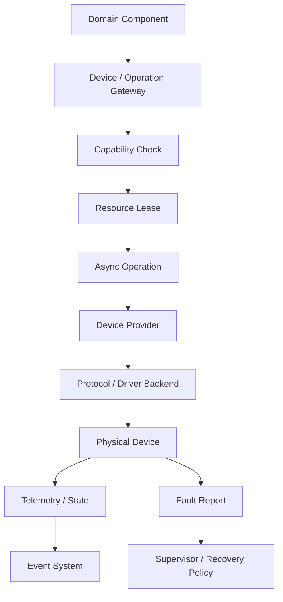
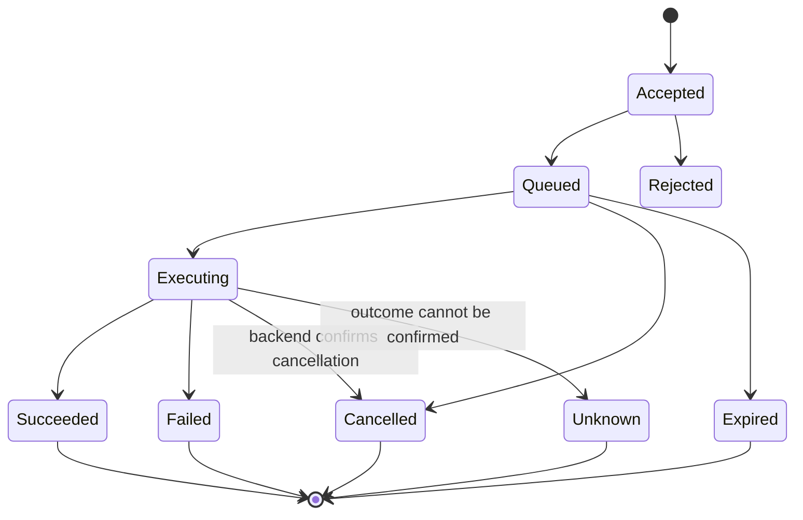

# 06 — 通用设备框架（机器人仅预留）

## 6.1 当前范围声明

机器人硬件、驱动器、安全控制器尚未进入项目。当前不实现 ROS 2、MoveIt、机械臂运动控制或车辆控制。只定义可供未来领域接入的通用生命周期、权限、租约、操作、遥测和故障接口。

## 6.2 Device Core



## 6.3 通用接口

建议对象：

- `DeviceId`、`ProviderId`、`DeviceDescriptor`。
- `DeviceCapability`：设备支持的领域能力标识，不等于调用权限。
- `DeviceLifecycle`：Discovered、Configured、Inactive、Active、Degraded、Faulted、Offline、Maintenance。
- `DeviceHealth`、`DeviceFault`。
- `ResourceLease`：Exclusive / Shared / ReadOnly 等访问所有权。
- `Operation`：有 ID、授权、过期时间、状态、进度、结果、幂等键。
- `Telemetry`：状态/测量数据流。
- `DeviceProvider`：注册、探测、打开、关闭、报告能力。

## 6.4 Operation 状态



取消语义必须由 Backend 明确：排队时可取消不等于执行中一定可取消。对于 ICraft 当前同步 `forward`，执行中取消不能承诺。

## 6.5 设备抽象不做万能 API

Device Core 只统一身份、权限、生命周期、资源所有权、操作跟踪、遥测、故障报告。领域操作留给 Domain：

- Home Domain 可定义 `SwitchCommand`、`LockState`、`SensorReading`。
- 未来 Robotics Domain 可定义 `MotionGoal`、`JointState`、`Trajectory`。
- Automotive/Industrial Domain 也各自保留领域语义。

不要设计只含 `turn_on/turn_off` 的万能 Device Trait。

## 6.6 未来机器人扩展点（现在只占位）

未来可能由独立 Adapter 把机器人中间件暴露给 Device Core：

```text
Future Robotics Adapter (not implemented)
  ROS 2 Action / Topic / Service
          ↕ mapping
  Device Operation / Telemetry / Fault
```

OS 核心不依赖 ROS 2 类型，不依赖 MoveIt 类型，也不假设每台设备都由独立进程承载。

未来真实机器人接入时，另行决定 ROS 2、ros2_control、MoveIt、Gazebo/MuJoCo、DDS/Zenoh、RT Linux/RTOS/MCU 等技术。选择依据必须包括真实机械臂/驱动器手册、控制周期、总线、反馈频率、安全功能和 sim-to-real 误差。

## 6.7 故障与恢复

通用故障分类：Disconnected、Timeout、StaleTelemetry、BackendCrashed、ResourceLost、ProtocolError、HardwareFault、UnknownOutcome。

Recovery Policy 必须按设备领域配置。普通组件重启不代表物理设备恢复；禁止 Device Core 默认 `restart()` 或 `power_off()`。危险命令不得在设备重连后自动重放。

## 6.8 当前验收（Mock Only）

- [ ] Mock Device 注册、能力查询和注销。
- [ ] Namespace/Capability 授权。
- [ ] Lease 独占冲突和释放。
- [ ] Operation 接受、排队、取消、过期、失败、未知结果。
- [ ] Telemetry 更新和过期检测。
- [ ] Fault 上报、Supervisor 协调。
- [ ] Provider 崩溃后 Lease 回收与重连检查。
- [ ] API 不导入 ROS 2 / MoveIt crate。
