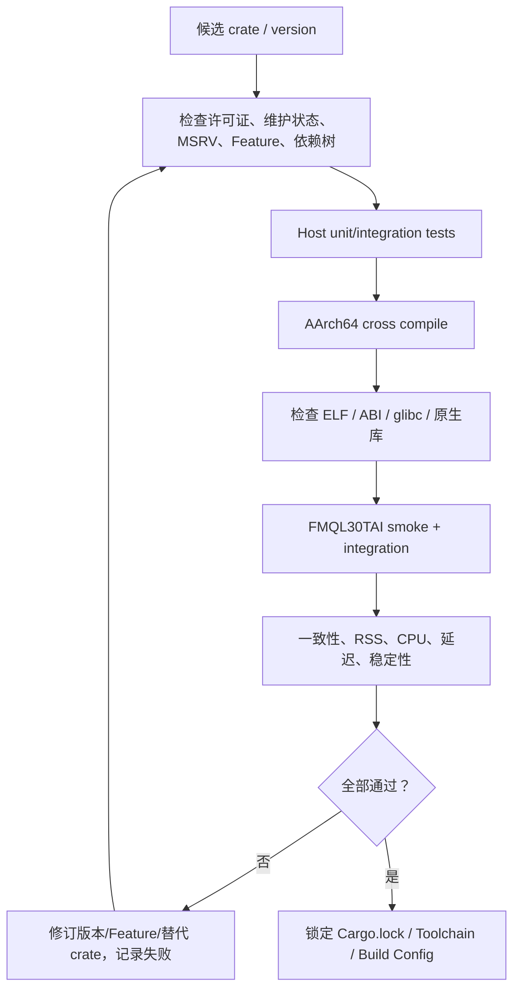

# 08 — 依赖准入、交叉编译与板上验证

## 8.1 目的

任何 crate/原生依赖最终固定版本前，必须证明它能在目标 AArch64 ABI 和 FMQL30TAI 实际 Linux 环境运行。不是所有纯 Rust crate 都要单独上板；按依赖组合和运行路径分层验证。

## 8.2 依赖准入流程



## 8.3 每个候选 crate 的记录字段

- crate 名称、版本、来源、许可证。
- 上游维护状态和最近 release。
- MSRV、目标平台与 `no_std/std` 要求。
- 默认 Feature 和实际启用 Feature。
- 完整依赖树及原生 C/C++/系统库依赖。
- x86_64 测试结果。
- AArch64 编译结果、linker、sysroot、ABI。
- 板上运行结果、RSS/CPU/延迟。
- 已知限制和替代方案。
- 最终裁定：采用、备用、拒绝、待测。

## 8.4 目标编译

当前目标环境是 AArch64 Ubuntu 20.04.4 + Linux 5.4.52。`aarch64-unknown-linux-gnu` 可以作为候选 target，但必须使用与板端兼容的 linker、sysroot 和 libc。不能仅凭 target 名称判定 ABI 匹配。

示例：

```bash
rustup target add aarch64-unknown-linux-gnu
cargo check --target aarch64-unknown-linux-gnu
cargo build --release --target aarch64-unknown-linux-gnu
```

有 C/C++ 依赖的 crate 还需检查 `build.rs`、pkg-config、交叉 sysroot、静态/动态链接库与目标端 SONAME。不能使用 `target-cpu=native` 生成 x86 主机特化代码；目标 CPU 参数按 Cortex-A53 实测与 Rust target support 确定。

## 8.5 三层测试

### Host CI

- `cargo fmt --check`
- `cargo clippy`（按 workspace policy）
- Unit / integration tests
- Schema、错误和状态机测试
- 安全边界/越权测试

### Cross CI

- AArch64 `cargo check` 和 release build。
- ELF machine、动态依赖、glibc/ABI 检查。
- 原生库链接检查。
- SBOM/许可证扫描。

### Hardware CI / 手工验收

- 在 FMQL30TAI 运行 smoke 和 integration tests。
- 记录 RSS、峰值内存、线程数、CPU、启动时间、延迟。
- 检查服务退出、资源释放、重启恢复。
- NPU/FPGA/DMA 测试必须遵循风险等级，不在无人值守时进行可能挂死硬件的测试。

## 8.6 一致性测试

同一输入在 x86 与 AArch64 上比较：

- 序列化/反序列化结果。
- Schema 验证结论。
- Revision Conflict 行为。
- 错误类型和状态转换。
- 算法/推理数值误差（允许范围需按模型预先定义）。

平台差异项单独标记，不要求所有性能数字一致。功能一致、ABI 兼容和性能达标是不同验收维度。

## 8.7 依赖锁定

部署型应用提交：

- `Cargo.lock`
- `rust-toolchain.toml`
- `.cargo/config.toml`（如确实需要）
- 构建环境/镜像版本
- 目标板 libc/原生库版本记录

版本锁定必须发生在候选验证之后。升级依赖时重新执行受影响的 Host/Cross/Hardware 测试。

## 8.8 Hardware CI 风险等级

- L0：纯算法、Serde、Schema、状态机，可自动运行。
- L1：文件、SQLite、普通进程生命周期，可使用测试用户和隔离目录。
- L2：DMA、NPU 正常推理，需确认不影响现役链路和内存窗口。
- L3：可能导致 NPU/AXI 挂死、需断电恢复的测试，必须人工批准、现场有人、有恢复方案；不得放进常规 PR CI。
