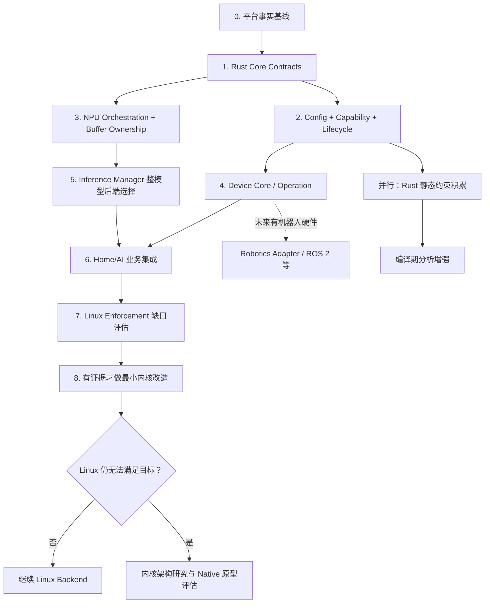

# 02 — 开发路线与阶段闸门

> **层级**：本文是 `architecture/` 的**跨机型现行版**（编号镜像 `baseline/`）。本机型的具体读数与取舍见 `platforms/<机型>/` 下的同号文件；两者冲突时以本层为准并留记录。

## 2.1 路线总览

## 2.2 阶段定义

### P0 — 平台事实基线（主要已完成）

目标：让后续设计不再依赖通用 Linux 假设。

- [x] 记录板卡、BSP、Ubuntu、Kernel、CPU、内存。
- [x] 记录 cgroup/Namespace/seccomp/LSM 实际缺失。
- [x] 记录 SCHED_FIFO/RR/DEADLINE 实际可用性。
- [x] 记录厂商推理 Runtime 的 API 面、同步阻塞行为、是否有 Scheduler/取消 API。
- [x] 记录平台存储域、DMA、Cache、IOMMU 边界。
- [x] 更新 NPU 挂死恢复事实与已完成板测。
- [ ] 为本地原始输出建立可长期追溯的 `raw_logs/`/证据归档（若现有 Wiki 已归档则链接即可）。

### P1 — Rust Core Contracts

先定义稳定领域对象，不急于拆成大量进程：

- Resource ID / Component ID / Execution ID。
- Capability 与 Access Scope。
- Resource Lease 与所有权状态。
- Work / Operation / Execution Contract。
- Error Code 与版本语义。
- Clock/Deadline 的时钟语义。

验收：对象有序列化格式、状态机、单元测试和版本兼容测试；不暴露 Linux PID/TID 或厂商 Runtime 内部类型。

### P2 — Configuration + Capability + Lifecycle

- ConfigNamespace、ConfigProvider、Schema Registry。
- Config Transaction、Revision、Outbox、Desired/Applied。
- Capability 授权、撤销和审计。
- Component Manifest、依赖、生命周期。
- Supervisor 与 Recovery Policy。

验收：组件只能通过授权的 Namespace/Capability 读写配置；崩溃后能检测并安全恢复；配置提交与事件不会失配。

### P3 — NPU Orchestration + Buffer Ownership

- 单一 NPU Owner 服务。
- 请求排队、准入、资源检查、模型会话生命周期。
- 厂商推理 Runtime 的 FFI 边界。
- DMA/共享 Buffer 类型、Cache Sync、所有权交接。
- 厂商错误码的语义与恢复分级。

验收：并发客户端不会直接并发打开多个厂商 Runtime Server；Buffer 不会在 NPU 尚未完成访问时释放；硬件挂死不会被错误地报告为可自动恢复。

### P4 — Generic Device Core / Operation

- Device Descriptor / Provider。
- Device Lifecycle / Health / Fault。
- Exclusive/Shared Lease。
- Operation：Accepted/Queued/Executing/Succeeded/Failed/Cancelled/Expired。
- Telemetry 与资源使用报告。

验收：用 Mock Device 验证发现、授权、操作、超时、取消、断连和恢复；当前不实现机械臂或 ROS 2。

### P5 — Inference Manager

- CPU Backend：先建立现有 ORT 路径基线，再评估 tract。
- 厂商 Runtime Backend：通过 FFI 和单 Owner 编排调用。
- 整模型 CPU/NPU 选择。
- Model Profile：延迟、内存、精度、数据搬运成本。
- 可解释的拒绝、排队、fallback 策略。

验收：同一 API 可跑 CPU/NPU；自动选择基于逐模型实测，不凭算力规格猜测；CPU fallback 仅在错误可恢复且状态一致时发生。

### P6 — Home/AI 集成

- 业务服务接入 Configuration Service、Operation、Device Core。
- 事件驱动和持久化流程保持明确。
- 数据面 Buffer 与控制面 RPC 分离。
- 现有 Python 服务可保留为后端，也可逐步替换；不设语言迁移配额。

验收：端到端业务链路稳定，服务重启后状态、配置与操作结果可恢复。

### P7/P8 — Linux Enforcement

先用当前内核真实提供的能力；再对安全和性能缺口逐项提出改造。

- 评估内核配置开启 Namespace/seccomp/LSM/cgroup controller 的成本。
- 评估厂商模块与新内核配置的兼容性。
- 评估 PREEMPT_RT 与厂商 `.ko` 重编/闭源模块兼容。
- 评估 SMMU DT 补全与设备隔离可行性。
- 只对有可复现需求的部分做最小补丁。

验收：每个补丁有威胁模型、测试、回退方案和目标板测量；不把“配置项已启用”当成“功能已运行”。

### P9/P10 — Rust Static Assurance

并行积累：Newtype、Typestate、Trait、Lifetime、Proc Macro、Clippy/MIR 数据流分析。

只有当重复安全规则无法通过普通 Rust API/宏/静态分析表达时，才评估 rustc 改造。Native Kernel 不是当前里程碑。

## 2.3 近期并行工作流

| 工作流 | 近期工作 | 不应提前做 |
|---|---|---|
| OS Core | ID、权限、Lease、组件状态模型 | 自研内核线程/内存管理 |
| Config | Namespace、Schema、Revision、Outbox | 自研序列化/数据库 |
| Inference | 厂商 Runtime FFI、单 Owner、Buffer 所有权 | 自研 ONNX Compiler/NPU Runtime |
| Platform | Linux Backend 真实能力映射 | 假定 cgroups v2/LSM 已可用 |
| Device | 通用 Device/Operation/Fault + Mock | 机械臂控制、ROS 2 部署 |
| Validation | 目标架构构建 + 目标机型基准 | 未经受控窗口进行 NPU 挂死注入 |

## 2.4 阶段变更规则

任何模块从“计划”变为“实现”前，必须明确：调用方、输入/输出、权限边界、故障行为、目标板验收方式。任何技术选型替换必须记录：替换原因、现有方案不足、性能/内存/维护代价、回退方案。
