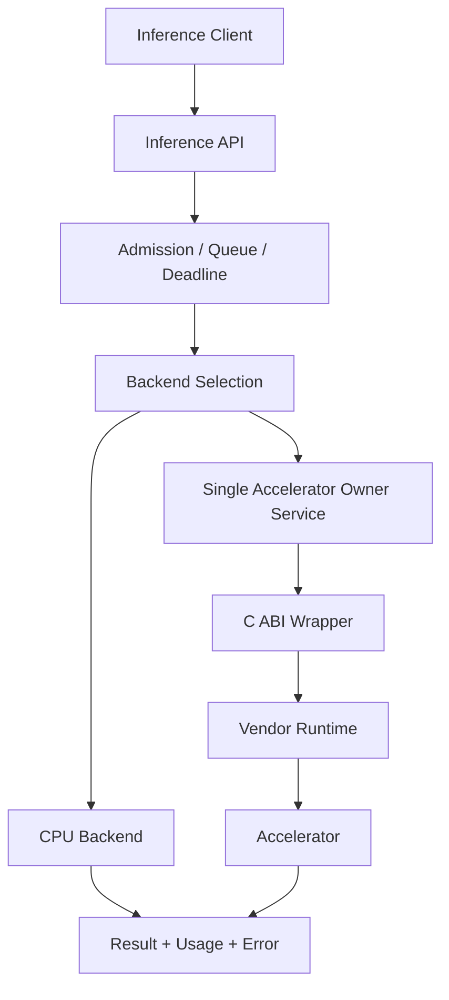

# 05 — 推理编排契约

> **层级**：本文是 `architecture/` 的**跨机型现行版**（编号镜像 `baseline/`）。本机型的具体读数与取舍见 `platforms/<机型>/` 下的同号文件；两者冲突时以本层为准并留记录。
>
> **文档定位**：跨机型约束与接口。本文定义**推理请求从进入到返回**的编排契约、FFI 边界、后端选择原则与各机型必填的适配表。
> **不写**：某厂商 Runtime 的版本、API 清单、算子面、精度档、内存读数——那些写在 `platforms/<机型>/05-inference-*.md`。

---

## 5.1 目标与边界

统一推理接口：对上层提供**同一套**提交/查询/取消语义，对下层协调 CPU、加速器与可编程逻辑。

**边界三条**：

1. **复用厂商编译器与 Runtime，不重写其内部执行系统。**
2. **系统级编排（排队、准入、分时、公平性、恢复）属于我方**——厂商 Runtime 通常不提供系统级 Scheduler。
3. **不假定厂商 Runtime 的并发能力**，必须逐条取证。

---

## 5.2 数据流（跨机型一致）



**默认策略**：一个受控的 Owner 服务管理设备生命周期与调用队列；**普通应用不直接打开多个 Runtime Server**。是否能在同一 Backend 内安全并发，需要独立证据，**不从 demo 推导通用保证**。

---

## 5.3 Orchestration 职责（固定清单）

| 职责 | 要求 |
|---|---|
| 请求队列与准入 | 明确的准入判据；拒绝要可观测，不静默排队 |
| 模型/Session 生命周期 | 加载、复用、释放的所有权归属明确 |
| Deadline / Timeout | 区分"请求超时"与"执行失败"（见 `13-failure-classification-and-recovery.md` §13.13.4） |
| Buffer 生命周期与访问所有权 | 见 `12-resource-lease-and-buffer-ownership.md` §12.4 |
| Backend 使用统计 | 每后端可报吞吐/延迟/占用 |
| 错误分类与恢复等级 | 映射到 `13-failure-classification-and-recovery.md` §13.1 |
| 状态上报 | `accepted / queued / running / completed / failed / unknown`，**不得把 unknown 报成 failed 或 completed** |

---

## 5.4 同步阻塞后端的通用约束

多数厂商 Runtime 的 `forward` 是**同步阻塞且无 cancel/abort**。由此产生的契约（跨机型成立，不依赖具体厂商）：

| 事实 | 必须兑现的约束 |
|---|---|
| 排队中的请求可取消 | 取消要在进入 `forward` **之前**生效 |
| 已进入 `forward` 的请求不能承诺及时取消 | API 必须能返回 `timeout_unknown` 语义 |
| 超时返回 ≠ 硬件已停止访问 Buffer | **此时释放 Buffer 即为 use-after-free** |
| 未确认任务结束前不能释放 Buffer | 必须有"完成确认"这一可观测点 |
| 严重挂死可能需断电 | 不得把"进程重启"或"reset API"当作可恢复方案（见 `13-…` §2） |

---

## 5.5 FFI 边界契约

```text
Rust API → safe wrapper → C ABI → C++ Vendor Runtime → Device
```

**硬要求**：

- opaque handles、固定宽度整数、显式错误码、明确 Buffer ownership。
- **所有 C++ exception 必须在 C++ 边界 catch 并转错误码**；禁止异常跨 C ABI。
- `unsafe` 集中在少量 FFI/Buffer 模块，不扩散到业务层。
- FFI 层不得持有业务语义（优先级、公平性、配额都由上层 Orchestration 决定）。

---

## 5.6 CPU Backend 评估口径

先建立"当前可用的 ONNX 运行路径"作为基线，再评估替代实现（如 Rust 原生推理引擎）：

| 维度 | 判据 |
|---|---|
| 算子与 Shape 覆盖 | 目标模型能否完整跑通 |
| RSS / 峰值内存 | 见 `12-…` §6 的适配表 |
| 加载时间 / 首次推理 / 稳态 P50·P95 | 三者分开报，不混用 |
| 单线程 / 多线程 CPU 占用 | 与机型核数一起报 |
| 数值一致性 | 与基线逐张量比对 |
| 构建与部署复杂度 | 交叉编译、依赖树、二进制体积 |

**不得因为某实现是"目标语言写的"就直接选它，也不得因为另一实现"已经在跑"就排除它。**

---

## 5.7 整模型选择优先，子图混合后置

- **第一阶段**：同一模型分别准备各后端版本，按支持矩阵、延迟、数据位置、搬运成本、内存压力与 Deadline **整模型**选择。
- **第二阶段**：只有在能明确导出/编译连续子图、共享中间 Buffer、且**同步开销低于收益**时，才做跨后端子图执行。
- **不得**把"自动 host 回退"或"Session 切分 API 存在"当作"混合调度已被系统化验证"。

---

## 5.8 各机型适配表（必填）

| 项 | 要求 |
|---|---|
| **Runtime 版本与 API 面** | 版本号、可用 API 清单、是否有 Scheduler / cancel / 多 Server |
| **精度档** | 支持的 `qdtype`、是否支持 asymmetric、校准要求 |
| **算子面** | 入口 opset、已知不支持/降级到 host 的算子、不支持的模型黑名单 |
| **内存路径** | 加速器可达的存储域、DMA 路径、单次推理峰值占用 |
| **恢复等级** | 见 `13-…` §3，逐级填 |
| **验收读数** | 至少一条本机实测（延迟/内存），不接受引用他机数值 |

---

## 5.9 相关

- `11-execution-and-resource-model.md` —— 执行对象与实施等级
- `12-resource-lease-and-buffer-ownership.md` —— Buffer 所有权与地址域
- `13-failure-classification-and-recovery.md` —— 故障分级与 `timeout_unknown` 语义
- `baseline/05-inference-zg330.md` —— 原始版本（以 ZG330/ICraft 为背景写成）
