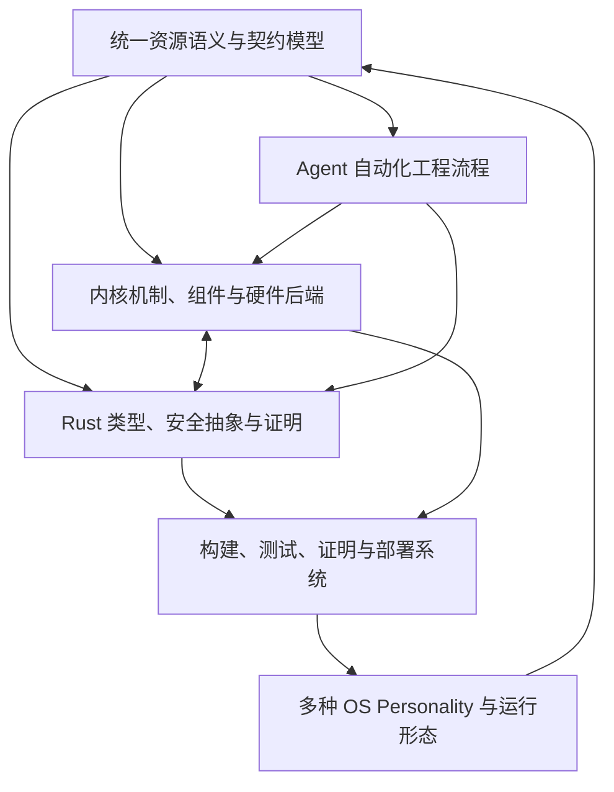
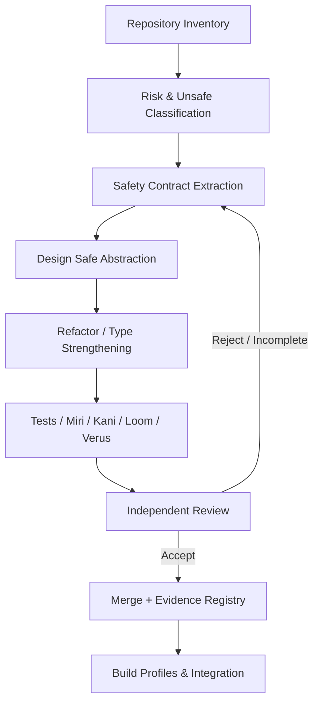

# 可组合、高保证通用操作系统总体设计纲要

> **核心定位：以 Rust 为主要系统实现语言，以 Agent 驱动工程自动化，以更严格的类型与证明约束安全边界，以细粒度、可组合的内核机制承载多种执行模型、硬件架构和 OS 接口标准。**
>
> 不以发明新语言、复制某一个现有内核或统一所有接口为前提。目标是把现有研究中的有效思想组合成可逐步实现、可替换、可验证的系统。

## 0. 执行摘要

整个构想可以从思考上分成三条主线：

1. **Agent 代工自动化**：让 Agent 承担代码盘点、unsafe 分析、安全重构、类型增强、契约生成、测试与证明任务；由独立审查和真实验证工具把关。
2. **语言安全严格化**：不急于设计新语言，先把 Rust 的安全边界收紧。通过安全抽象、Typestate、Capability、精化约束、契约和形式化验证，让更多非法操作在编译期被排除，让残余 unsafe 变小、集中、可证明。
3. **内核细化通用化**：把内核和 OS 服务拆成边界明确、可组合的机制、资源、策略、执行模型、硬件后端与接口 Personality；允许不同体系并存，不强迫它们采用同一架构或最低公分母接口。

这三条是**思考和组织工作的维度，不是三个互相独立的实现子系统**。实现时它们完全交织：

- 内核提供细粒度资源、权限、操作和状态契约；
- Rust 类型与安全抽象把契约编码为编译期约束；
- 证明工具检查安全抽象、算法与协议是否满足契约；
- Agent 读取同一份契约与证明义务，实施重构、补充测试和证明材料；
- 构建系统根据组件声明和平台能力，组合出不同部署形态与接口 Personality。

整个系统的共同基础不是某一种语言或某一种内核，而是：

**统一资源语义 + 统一契约描述 + 可组合组件模型 + 可追溯证明证据 + 可自动化构建部署。**

## 1. 目标与非目标

### 1.1 目标

- 以 Rust 作为主要系统开发语言，先利用和强化现有生态，不把新语言作为前置条件。
- 将 unsafe 从普通业务和服务代码中尽可能移除，无法移除的部分缩小为明确的可信实现边界。
- 使安全 API 不只是“编译通过”，而是有明确不变量、前后置条件、失败语义和必要的机器可检查证据。
- 内核机制高度细粒度，但不将“细粒度”误解为“每个功能都必须独立进程”。
- 允许同一套系统机制以不同部署方式组合：同地址空间组件、独立进程、微内核式服务、混合部署、嵌入式裁剪配置等。
- 允许多套 OS 接口标准共存，例如 Native API、POSIX、Linux ABI、WASI，以及其他未来接口。
- 支持不同 CPU ISA、MMU/IOMMU 能力、总线、DMA、GPU、NPU、FPGA、存储和网络设备。
- 通过 Manifest、契约和构建图，使 Agent 与构建工具能够理解组件依赖、权限和验证要求。

### 1.2 非目标

- 不要求所有代码都没有 `unsafe`。目标是最小化、隔离、解释并验证 unsafe，而不是机械删除关键底层操作。
- 不要求所有资源共用一个万能 Trait 或统一操作集合。
- 不要求所有组件都运行在独立地址空间，也不要求所有组件都在同一地址空间。
- 不要求所有接口标准都被翻译成同一套最低公分母 API。
- 不要求立即实现完整 Linux ABI、POSIX 全集、WASI 全版本或全部 CPU 架构。
- 不把 Miri、测试、模型检查、形式化证明或硬件隔离中的任何单项当作“系统绝对安全”的证明。
- 不把 Agent 的解释或自我评估当作证明证据。

## 2. 三条思考主线，以及它们如何融合

### 2.1 主线 A：Agent 代工自动化

Agent 是整个工程生命周期中的自动化参与者，不是独立于 OS 的一个“代码生成层”。它可以处理：

- 仓库与依赖盘点；
- unsafe、FFI、裸指针、汇编、Send/Sync、内部可变性等风险分类；
- 安全义务和不变量提取；
- API 与类型重构；
- 测试、Miri、Kani、Loom、Verus 等验证任务的生成与执行；
- 文档、契约、证明清单和变更记录维护；
- 与内核组件 Manifest、目标平台能力和部署 Profile 对齐。

Agent 的核心职责是**把工程工作转化为可检查的变更与证据**，而不是自行宣布代码安全。验证结论由编译器、测试、模型检查器、证明器、硬件测试和人工审查分别给出。

### 2.2 主线 B：语言安全严格化

不以新语言为前置条件，先建立项目自己的 Rust Safety Profile：

- 默认禁止普通模块使用 unsafe；
- 对 unsafe 块、unsafe fn、unsafe impl、FFI 和汇编建立统一审计要求；
- 优先使用安全标准库 API 和成熟封装；
- 使用 Newtype、Typestate、私有构造器、Capability 句柄等限制非法状态；
- 视场景引入 Flux 一类精化类型思想，约束范围、长度、索引和数值不变量；
- 以 Verus、Kani、Loom、Miri 等验证不同性质；
- 对高风险安全抽象研究 RustBelt、Iris、RefinedRust、Gillian-Rust 等方法。

Rust 的仿射所有权并不等于严格线性类型。尤其不能假设 `Drop` 必然执行：安全代码可以通过 `mem::forget` 遗弃值。因此，设备 Lease、DMA 归还、锁释放等关键安全保证不能只依赖析构函数；必要时还要由内核状态、Capability、硬件隔离或显式恢复协议兜底。

### 2.3 主线 C：内核细化通用化

把内核设计从“选微内核还是宏内核”转向“定义足够细的机制和契约，并允许不同部署组合”。

- 分离机制与策略；
- 分离资源身份、访问权、所有权、生命周期和操作协议；
- 分离组件逻辑模型与物理部署/保护域；
- 分离硬件能力接口与架构专用扩展；
- 分离 Native 内部语义与外部 OS Personality/ABI；
- 允许同一功能在不同配置下位于内核、同地址空间库或独立服务中。

### 2.4 三条主线的融合关系



实现上的闭环是：

1. 内核设计定义资源、权限、操作和状态转换；
2. Rust API 把其中可静态表达的部分编码到类型；
3. 契约与证明工具验证剩余不变量；
4. Agent 根据同一契约对代码进行修改并更新证据；
5. 构建系统组合组件、后端与 Personality；
6. 运行时强制执行无法完全静态证明的权限、资源和硬件约束；
7. 运行结果、故障和验证发现反过来更新契约与实现。

因此，三条主线在组织上可分，在系统数据模型和工程流水线上必须共用基础设施。

## 3. 统一基础：资源模型与安全契约

这是三条主线真正汇合的关键。

### 3.1 资源模型

系统中的资源应当有共同元数据，但不能被强行统一为相同操作接口。

共同元数据建议包括：

| 字段 | 含义 |
|---|---|
| Resource ID | 稳定身份，避免只依赖裸指针或设备路径 |
| Resource Type | 资源种类和版本 |
| Owner | 当前负责管理资源的主体 |
| Rights | 对资源允许执行的权限集合 |
| State | 当前生命周期/协议状态 |
| Lease / Token | 有时效或状态约束的使用权凭证 |
| Lifecycle | 创建、激活、停止、撤销、回收、恢复等阶段 |
| Accounting | 配额、使用量、预算与归属 |
| Contract | 操作约束、失败语义、平台假设和验证要求 |

必须区分：

- **Resource**：资源本身，例如物理页、CPU 时间、设备队列。
- **Ownership**：谁负责管理或决定资源状态。
- **Capability / Rights**：谁被允许做什么。
- **Lease**：在某个时间或状态范围内使用资源的授权。
- **State**：资源目前处于什么阶段。
- **Operation**：对资源实施的具体动作。

它们不可混为一谈。例如共享引用不代表拥有修改权限；拥有 Buffer 的管理权不代表设备已经停止 DMA；有权提交 GPU 队列不代表有权重置 GPU。

### 3.2 资源不使用万能操作接口

不要设计把所有资源都压成 `acquire/release/start/stop` 的万能 Trait。

| 资源 | 自己的典型操作 |
|---|---|
| Memory Page | Allocate、Map、Unmap、Reclaim |
| CPU Core / Time Budget | Bind、Reserve、Preempt、Release |
| DMA Buffer | Prepare、Submit、Complete、Revoke、Recover |
| GPU/NPU Queue | Create、Submit、Fence、Drain、Reset |
| Network Interface | Configure、Transmit、Receive、Reset |
| Storage Region | Read、Write、Flush、Discard |
| USB Device | Enumerate、Configure、Transfer、Disconnect |

通用的是身份、权限、生命周期和契约表示方式；具体操作及状态机属于资源类型本身。

### 3.3 安全契约模型

每个重要类型、组件、服务和接口都应能关联一份机器可读或可解析的契约。

契约至少记录：

- 身份、版本和所属组件；
- 输入/输出类型；
- 前置条件与后置条件；
- 资源所有权、权限及转移规则；
- 状态机和合法操作顺序；
- 可观察副作用（Effect）；
- 并发与同步语义；
- 错误、超时、取消和恢复语义；
- 时间、内存、队列等资源预算；
- 目标硬件与平台能力要求；
- 验证方法、证据、假设和未解决风险。

**接口签名只是契约的一小部分。** `fn submit(buffer) -> Job` 并没有说明提交失败时 Buffer 归谁、设备完成如何证明、超时是否意味着硬件已停止访问。

## 4. 系统逻辑架构

下面是逻辑分层，不意味着必须编译成固定数量的进程或 crate。

### 4.1 Hardware / Architecture Backend

职责：抽象 CPU ISA、异常、中断、页表、缓存、原子操作、总线、DMA 和平台设备能力。

设计要求：

- 通用能力与架构原生扩展分开；
- 通过能力描述声明支持项和不支持项；
- 不允许某个平台为了通过通用 Trait 而假装具有 IOMMU、硬件一致性或任务取消能力；
- 具体架构后端负责将通用语义落实为本架构操作；
- 平台假设纳入契约和验证报告。

示例能力：MMU、IOMMU/SMMU、硬件虚拟化、Cache Coherency、原子宽度、IRQ 控制器类型、DMA 限制。

### 4.2 Kernel Mechanisms

建议按机制域拆细：

- Memory：物理页、虚拟映射、内存对象、共享内存、分配器接口；
- Execution：Task、Thread、Context、CPU Affinity；
- Scheduling：优先级、Deadline、Budget、抢占、调度域；
- IPC：消息、Endpoint、Channel、Notification、Shared Memory；
- Synchronization：Mutex、Semaphore、Event、Wait Set、Atomic；
- Capability：对象权限、Delegation、Revocation、Transfer；
- Interrupt/Timer：路由、确认、时钟、期限；
- Fault：异常投递、隔离、恢复；
- Accounting：配额、预留、使用量和资源核算。

机制与策略分离。例如内核提供线程状态转换、抢占和定时器机制；EDF、固定优先级或公平调度是可替换策略。

### 4.3 Execution & Component Model

组件逻辑模型与组件部署位置分离。一个 Actor 不必天然等于一个进程；同地址空间组件也不意味着它们没有逻辑隔离边界。

可支持的执行模型包括：

- Kernel-resident：极少数特权机制；
- Same-address-space：可信组件直接调用；
- Isolated Process：独立地址空间服务；
- Actor / Message-driven：消息驱动、状态封装；
- Cell：较细粒度的语言级组件；
- Coroutine / Async Task：协作式任务；
- VM / Sandbox：需要更强隔离的第三方程序。

同一组件契约可以绑定不同传输后端：直接调用、共享内存、IPC 或虚拟机边界。但必须明确它们在延迟、失败、取消、内存共享和可用性方面是否等价。

### 4.4 OS Services

服务按功能域独立组织，例如：

- Device：Registry、Bus Manager、Driver Framework、Lifecycle、Resource Multiplexer；
- Storage：Block Layer、Filesystem、Volume、Cache；
- Network：Interface、Protocol Stack、Routing、Socket；
- Process：Loader、Process Manager、Session、Runtime；
- Resource：Broker、Lease、Quota、Accounting。

服务部署在内核还是用户态是 Profile 决策，不应由目录结构预先决定。

设备模型必须区分 Bus、Device、Device Class、Resource、Operation、Driver Model 和 Device Protocol。PCIe、NVMe、USB、GPU 命令队列、NPU 推理任务并不是同一种操作接口。

### 4.5 OS Personalities / ABI Compatibility

Native 系统语义与外部标准适配分离。至少区分三类接口：

| 接口类别 | 示例 | 主要解决的问题 |
|---|---|---|
| Source API | POSIX API、Native Rust API | 程序源代码如何调用系统 |
| Binary ABI | Linux syscall ABI、ELF 约定 | 已编译二进制如何运行 |
| Wire / Component Interface | WIT、FIDL、Typed IPC | 组件如何交换数据和能力 |

建议独立提供：

- Native Personality：类型化 Capability、资源 Lease、异步 Operation、Typed IPC；
- POSIX Personality：文件描述符、进程/线程、信号、mmap、poll、Socket 等语义；
- Linux ABI Personality：ELF、syscall、Linux 特有结构和行为、futex/epoll/ioctl 等；
- WASI Personality：按对应 WASI/WIT/Component Model 版本实现其能力和组件语义；
- 其他标准：作为可安装/可组合适配层增加。

POSIX API 存在不代表 Linux 二进制兼容；Linux syscall 名称对应上也不代表完整 Linux ABI 兼容；WASI 也不应被强行翻译成 POSIX。

适配器必须声明映射质量：

- `Equivalent`：相关可观察语义等价；
- `Refinement`：目标实现满足源接口要求，但可能收紧能力；
- `Emulated`：通过额外组件模拟；
- `Partial`：只实现明确列出的子集；
- `Unsupported`：明确不支持。

不得把 Partial 或 Unsupported 功能伪装成成功；错误、取消、并发、权限和资源生命周期语义必须纳入兼容性评估。

## 5. 组件 Manifest 与系统组合

组件声明自己提供什么、需要什么、允许怎样运行、需要哪些资源和证明等级。构建器根据 Manifest、平台能力和 Profile 生成系统组合图。

示意：

```yaml
component:
  id: device.npu
  version: 1

  provides:
    - native.compute.queue.v1

  requires:
    - memory.dma
    - interrupt.routing
    - capability.device-access

  execution:
    supported:
      - same-address-space
      - isolated-process
    preferred: isolated-process

  resources:
    dma: required
    interrupt: required

  capabilities:
    - device.compute.submit
    - device.compute.query

  contracts:
    - device.lifecycle.v1
    - dma-ownership.v1

  verification:
    required:
      - unsafe-audit
      - state-machine-tests
```

这是提案格式，不是现成标准。字段应随着契约模型逐步稳定。

### 5.1 部署 Profile

同一套组件与机制可以生成不同部署组合：

- Microkernel-like：少量内核机制，主要服务独立隔离；
- Hybrid：性能关键机制或服务位于可信域，其余隔离；
- Monolithic-like：符合要求的模块静态链接/同域部署；
- Embedded / Unikernel-like：裁剪服务并组成专用镜像；
- Hosted Development：在现有 OS 上运行原型与验证后端。

这些是部署 Profile，不代表同一个内核实例同时具备所有架构的完整属性。一个系统可以允许不同组件选择不同隔离方式；系统配置决定最终组合。

### 5.2 配置检查

构建器至少检查：

1. 依赖是否满足；
2. 能力与硬件资源是否存在；
3. 接口版本和契约是否匹配；
4. 组件是否支持所选执行模型；
5. 权限是否满足最小化原则；
6. 所需证明证据是否齐备；
7. 适配器的功能覆盖是否满足目标 Profile。

## 6. Rust 安全与证明体系

### 6.1 Rust Safety Profile

建议项目统一规定：

- 普通业务/服务 crate 默认 `#![forbid(unsafe_code)]`；
- 可信底层 crate 显式允许 unsafe，并开启严格 lint；
- 使用 `unsafe_op_in_unsafe_fn`、undocumented unsafe block 等检查；
- 每个 unsafe 块说明具体前置条件和不变量，而非泛泛写“调用者保证”；
- `unsafe impl Send/Sync` 必须独立论证；
- FFI、MMIO、DMA、汇编必须列出平台假设；
- 安全封装必须说明所有安全调用组合都不会破坏内部不变量；
- 依赖和工具链版本固定并记录。

### 6.2 类型增强

优先利用现有 Rust 表达：

- Newtype：分离物理地址、虚拟地址、DMA 地址、长度、页数等不同语义；
- Typestate：表达对象生命周期和合法状态转换；
- Capability handle：把资源身份和权限分离；
- 私有构造器：防止任意构造不合法状态；
- 借用与生命周期：控制内存访问关系；
- 精化约束：表达 `index < len`、地址范围、对齐和数值关系；
- Session/Protocol-like API：限制操作顺序。

但 Rust 的 `Drop` 不保证必然执行；仿射类型也不是完整线性类型。涉及 DMA、设备任务、持久化资源和恢复的关键协议，应有内核或运行时兜底机制。

### 6.3 验证工具按证明义务选择

| 工具/方法 | 适合的任务 | 不应声称的结论 |
|---|---|---|
| rustc / Clippy | 类型检查、lint、代码规范 | 不等于功能正确性证明 |
| cargo-geiger | unsafe 使用量盘点 | 数量不能代表安全等级 |
| Miri | 执行路径上的 UB 检查 | 通过不等于所有路径 sound |
| Kani | 有界模型检查、断言和契约 | 受模型边界和语言支持限制 |
| Loom | 并发交错探索 | 不等于任意真实执行均已证明 |
| Verus | 规格驱动的算法/系统代码证明 | 只支持 Rust 子集，需显式规格 |
| Flux | 精化类型与数值/容器不变量 | 不是所有 unsafe 指针实现的通用证明器 |
| Gillian-Rust / RefinedRust | 研究级 unsafe Rust 半自动/形式化验证 | 需核实成熟度、支持范围和可复现性 |
| Iris / RustBelt | 资源逻辑、类型安全与安全抽象的理论基础 | 不是普通 CI 插件 |
| Perennial | 并发持久化与崩溃恢复证明 | 不适用于每个普通驱动函数 |

不要要求每个模块跑所有工具。应先写明要证明的性质，再选择工具。

### 6.4 证明结论分级

建议每条安全义务分别标注证据类型：

- `TypeChecked`：被 Rust 类型系统约束；
- `Linted`：静态规则检查通过；
- `Tested`：测试覆盖到的行为通过；
- `Explored`：模型检查/并发探索在声明边界内通过；
- `Proved`：在明确规格、模型和假设下存在机器检查证明；
- `HardwareEnforced`：由硬件权限机制强制；
- `Assumed`：依赖外部平台、固件或设备规格的假设；
- `Unverified`：尚无充分证据。

这些标签不能压成一个模糊的“安全”。安全性、功能正确性、活性、实时性、机密性、完整性和可用性应分开记录。

## 7. Agent 自动化工程体系

### 7.1 工作闭环



### 7.2 Agent 角色

| 角色 | 职责 | 权限边界 |
|---|---|---|
| Auditor | 盘点 unsafe、FFI、指针、并发和依赖风险 | 默认只读，不直接改代码 |
| Contract Designer | 提取前置条件、不变量、状态机和失败语义 | 不得把猜测写成事实 |
| Refactorer | 引入安全 API、类型和最小 unsafe 封装 | 不得降低功能、权限或测试强度 |
| Verifier | 生成并运行测试/证明 harness | 不能把测试通过宣称成形式化证明 |
| Independent Reviewer | 检查改动、契约、证据与残余风险 | 不直接接受生成者的自我结论 |
| Integrator | 检查跨组件契约、版本和部署组合 | 不得绕过缺失依赖或能力检查 |

可以由同一 Agent 系统调度多个角色，但高风险改动应采用不同上下文/独立审查，并由真实工具输出证据。

### 7.3 Unsafe-to-Safe 的处理原则

每个 unsafe 使用点只能归入以下结果之一：

1. **Replaced**：已被安全 API 完全替代；
2. **Encapsulated**：仍需 unsafe，但已封装在私有、安全抽象内部；
3. **Verified**：保留 unsafe，并完成特定证明义务；
4. **Assumption-Bounded**：依赖硬件/FFI/平台假设，已明确记录并实施边界控制；
5. **Unresolved**：尚未有足够证据，不得宣称完成。

不允许只删除关键字、扩大安全函数、编造 SAFETY 注释、删减断言或把失败改成默认成功。

### 7.4 变更粒度

优先以一个安全抽象、一个资源协议或一个模块为单位处理，而不是一开始全仓库批量改写。每项变更必须带：

- 原始代码位置与行为；
- 安全义务和不变量；
- 修改方案与类型变化；
- 测试和证明产物；
- 依赖工具版本；
- 未解决假设；
- 独立审查结论。

## 8. 运行时、静态证明与硬件强制的分工

不是所有安全约束都应该在同一层解决。

| 约束 | 首选保障位置 |
|---|---|
| 值域、索引、状态、所有权使用顺序 | 类型系统 / 精化类型 |
| 安全抽象内部内存不变量 | 形式化证明 + Miri/Kani 等检查 |
| 组件能否访问某资源 | Capability + 内核运行时检查 |
| 不可信组件隔离 | 地址空间、特权级、虚拟机等硬件保护 |
| DMA 访问范围 | IOMMU/SMMU（若具备）+ DMA 契约；否则明确扩大可信边界 |
| Cache 非一致性与内存屏障 | 架构后端 + 平台规格 + 测试/验证 |
| 任务超时与设备取消 | 明确的设备协议；超时不等于硬件停止 |
| 设备故障恢复 | Lifecycle/Fault/Recovery 状态机 + 硬件证据 |
| 实时期限 | 调度分析、WCET/预算和平台假设 |

硬件隔离不是语言安全的替代品；语言安全也不是硬件隔离的替代品。二者是纵深防御。

## 9. 关键设计决策

| 决策 | 当前建议 | 保留的自由度 |
|---|---|---|
| 主实现语言 | Rust | 可以引入局部 DSL、证明语言或生成式接口描述，不要求新系统语言 |
| unsafe 策略 | 最小化、封装、契约化、按义务验证 | 不强求零 unsafe |
| 内核架构 | 机制细粒度、部署形态可组合 | 不提前锁定纯微内核或纯宏内核 |
| 组件粒度 | 逻辑/类型/权限/地址空间粒度分离 | 同域组件可直接调用，必要时独立隔离 |
| 资源模型 | 统一元数据和契约，不统一具体操作 | 各资源定义专属状态机和操作 |
| 接口标准 | 独立 Personality / ABI 适配器 | 可以并存，不强行取最低公分母 |
| 硬件适配 | 通用能力接口 + 原生扩展 | 不伪造平台能力 |
| Agent | 负责实施和证据生成 | Agent 不担任最终可信证明者 |
| 编译器证明 | 长期研究方向 | 不作为当前 Rust 工程改造的前置条件 |

## 10. 实施路线

### Phase 0：建立工程基线

- 扫描 workspace、crate、依赖、unsafe、FFI、汇编、Send/Sync 和平台专用代码；
- 固定 Rust toolchain、目标平台、功能开关和构建配置；
- 记录测试、构建、性能和现有行为基线；
- 生成 Unsafe Inventory 与第三方依赖风险清单。

**交付物：** 仓库安全地图、基线报告、风险分级、未决问题列表。

### Phase 1：Rust Safety Profile

- 普通 crate 默认禁止 unsafe；
- 建立允许 unsafe 的 crate 清单；
- 统一 SAFETY 文档规范和审查模板；
- 建立 unsafe 计数、Miri 基础测试和 CI 规则；
- 为高风险 `unsafe impl Send/Sync` 单独建立记录。

**交付物：** 项目安全编码规范、Unsafe Registry、CI 基础门禁。

### Phase 2：契约与类型增强

- 先选 Memory、DMA Buffer、Device Handle、Task/Queue 等代表性对象；
- 建立 Newtype、Typestate、Capability 和资源状态机；
- 给操作增加前置条件、后置条件、失败/取消语义；
- 建立 Safety Contract Registry 和 Manifest 原型。

**交付物：** 核心资源类型、契约模板、组件 Manifest、契约检查工具原型。

### Phase 3：Agent Unsafe 重构闭环

- Auditor 盘点；
- Designer 写契约；
- Refactorer 提交安全重构；
- Verifier 运行匹配的验证工具；
- Reviewer 审核证据；
- CI 保存证据并阻止未经审查的高风险变更。

**交付物：** Agent 工作流、任务提示词、结构化审计报告和可追溯变更。

### Phase 4：关键模块形式化验证

优先选安全价值高、范围相对可控的模块：

- 位图/区间分配器；
- 页表映射与撤销；
- Capability 权限转移；
- IPC 状态机；
- DMA Buffer 所有权；
- 调度器关键不变量。

不要一开始就试图证明整个 OS。先证明能够复用的安全抽象。

**交付物：** 规格、Proof Harness、机器检查证明、假设清单。

### Phase 5：多后端、多执行模型与 Personality

- 先有一个可运行后端和一个完整资源模型；
- 再增加第二个平台/架构后端以验证抽象没有绑定首个平台；
- 支持组件不同部署模式；
- 增加 Native API 与一种外部 Personality；
- 用 Manifest 检查能力、依赖、契约和部署要求。

**交付物：** 后端接口、组件部署 Profile、适配器、兼容性测试套件。

### Phase 6：系统级保证与恢复

- 跨组件 Assume-Guarantee 证明；
- 活性、死锁、实时性和资源预算分析；
- DMA/中断/Cache/设备复位契约；
- 故障注入与恢复测试；
- 逐步研究编译器与二进制层证明。

**交付物：** 系统级保证论证、平台假设、故障恢复模型、机器码验证研究报告。

## 11. 第一批验证用例

为了验证架构而不是只验证抽象设计，建议第一批选五种不同性质的资源：

| 用例 | 主要检验点 |
|---|---|
| Memory Page | 地址、映射、权限、生命周期和撤销 |
| DMA Buffer | CPU/设备所有权转移、缓存同步、设备完成证据 |
| CPU Budget / Thread | 调度、时间预算、抢占和实时约束 |
| IPC Channel | 消息所有权、权限传递、错误和死锁 |
| GPU/NPU Queue | 异步任务、Fence、超时、故障、复位和恢复 |

如果这五种对象都能使用同一套身份、权限、契约、证据和 Agent 流程，同时保留各自专有操作，说明抽象方向有价值。若它们只能靠万能接口或大量特例才能接入，就应调整公共模型。

## 12. 成功标准

### 工程标准

- 普通服务代码能稳定保持 `forbid(unsafe_code)`；
- 每个残余 unsafe 都能定位到契约、审计和验证状态；
- Agent 不会仅凭关键字删除或注释补写宣称完成；
- 证明证据与具体 commit、工具版本、目标平台相关联；
- 同一组件可以根据配置选择不同部署位置；
- 新平台能力不足时会显式失败或降级，而不是伪装支持。

### 架构标准

- 新增一种资源不需要修改所有现有资源接口；
- 新增一种 OS Personality 不需要改写内核资源语义；
- 新增一种执行模型不要求改变组件的逻辑契约；
- 更换硬件后端不需要重写所有上层服务；
- 相同契约可以同时被类型检查、验证工具、内核运行时和 Agent 消费；
- 性能优化可以改变部署和传输后端，但不能静默改变安全契约。

## 13. 主要风险与防止过度设计

1. **抽象过度**：一开始定义太多通用 Trait。解决：用真实资源用例验证，每种资源保留原生操作。
2. **证明负担失控**：试图一开始验证整个内核。解决：先验证小型可复用安全抽象。
3. **工具链碎片化**：把多个研究工具全部设成强制 CI。解决：按证明义务选择，研究工具先单独试点。
4. **Agent 伪造安全**：生成貌似完整的 SAFETY 注释和测试。解决：证据分类、独立审查、反例检查和明确残余假设。
5. **兼容性虚标**：把部分 POSIX 或 syscall 映射宣传成完整 ABI。解决：逐项兼容矩阵和适配质量标记。
6. **硬件假设遗漏**：把软件类型保证误认为 DMA/固件行为保证。解决：硬件契约、平台能力声明和故障模型。
7. **模块粒度与进程粒度混淆**：每个模块都做成服务，导致 IPC 过多。解决：独立定义逻辑边界和部署边界。
8. **Drop 被当成强制资源回收**：假设析构一定执行。解决：显式资源状态、内核回收和恢复协议。

## 14. 总结性定义

本项目不是“用 Rust 写一个微内核”，也不是“让 Agent 自动删掉 unsafe”。

它要建立的是：

**一套以 Rust 安全抽象和形式化证据为基础、由 Agent 自动化维护、以细粒度资源与权限机制为核心、允许多种组件执行模型和 OS Personality 共存的可组合操作系统体系。**

三条主线在规划上分别研究，在实现上共用同一套资源语义、契约注册表、组件 Manifest、证明证据和构建部署系统。

最终效果不是所有东西长得一样，而是不同东西能够在明确的边界和契约下组合运行。

---

## 参考项目与资料

以下是设计思想的来源和后续研究入口，不代表它们已经提供本纲要要求的完整解决方案。工具能力与项目状态以使用时的官方文档和版本为准。访问日期：2026-11-09。

### Rust 安全与语言证明

- [Rust Project Goal: Project Zero (2026)](https://goals.rust-lang.org/2026/roadmap-project-zero.html)：修复已知类型系统 soundness 问题。
- [Rust Safety-Critical Rust (2026)](https://goals.rust-lang.org/2026/roadmap-safety-critical-rust.html)：安全关键工程证据、覆盖率、规范与 unsafe 文档。
- [Normative Documentation for Sound `unsafe` Rust](https://goals.rust-lang.org/2026/safe-unsafe-for-safety-critical.html)：为常见 unsafe 模式建立规范性安全条件文档。
- [RustBelt, POPL 2018](https://plv.mpi-sws.org/rustbelt/popl18/)：安全抽象、unsafe 库和 Rust 类型系统的机器检查证明。
- [Gillian-Rust, PLDI 2025](https://gillianplatform.github.io/publications/rust.html)：安全 Rust 自动验证与 unsafe Rust 定向半自动验证的混合路线。
- [Flux: Liquid Types for Rust](https://doi.org/10.1145/3591283)：把逻辑精化约束融入 Rust 所有权系统。
- [Verus](https://github.com/verus-lang/verus)：Rust 系统代码的规格驱动静态验证；当前只支持语言子集且仍在发展。
- [Kani](https://model-checking.github.io/kani/)：Rust 模型检查，适合边界明确的安全和正确性属性；并发支持和语言覆盖有局限。

### 内核、组件与硬件

- [Theseus OS, OSDI 2020](https://www.usenix.org/conference/osdi20/presentation/obozi)：Cell、intralingual design 和语言驱动 OS 设计。
- [seL4 Proofs](https://sel4.systems/Verification/proofs.html)：内核功能正确性及不同配置的证明范围。
- [Verve, PLDI 2010](https://www.microsoft.com/en-us/research/publication/verve-verified-microkernel/)：TAL 与 Hoare 逻辑结合的低层验证思路。
- [Vault, Microsoft Research](https://www.microsoft.com/en-us/research/publication/vault/)：线性资源协议、Adoption 与 Focus。
- [Terrier, ATS OS research](https://www.cs.cmu.edu/~rwh/papers/terrier/terrier.pdf)：依赖/线性类型用于低层 OS 和实时系统的研究路线。
- [Genode OS Framework Documentation](https://www.genode.org/documentation/index)：多底层平台、组件化系统和接口组合。
- [Genode Components Overview](https://genode.org/documentation/components)：驱动、资源多路复用器、协议栈和应用的组件分类。
- [Fuchsia Zircon Fundamentals](https://fuchsia.googlesource.com/fuchsia/+/refs/heads/main/docs/get-started/learn/intro/zircon.md)：内核对象、系统调用和用户态服务的参考。
- [CHERI](https://www.cl.cam.ac.uk/research/security/ctsrd/cheri/)：硬件 Capability 与内存访问权限模型。

### 编译器与崩溃恢复

- [CompCert](https://compcert.org/doc/)：Coq 证明的 C 编译器语义保持；不能直接当作 rustc 正确性证明。
- [CakeML](https://cakeml.org/)：带有验证编译器与证明工具链的语言项目。
- [Perennial](https://github.com/mit-pdos/perennial)：Iris 基础上的并发、崩溃安全与持久化系统验证。

### 重要解释

- 研究项目、原型和生产级工具要区分；论文证明某个子集，不代表完整工具链对所有 Rust 代码均可证明。
- `unsafe` 数量降低是工程指标，不是安全证明。
- 形式化证明只证明给定规格和假设下的性质；规格、模型和硬件假设本身也要审查。
