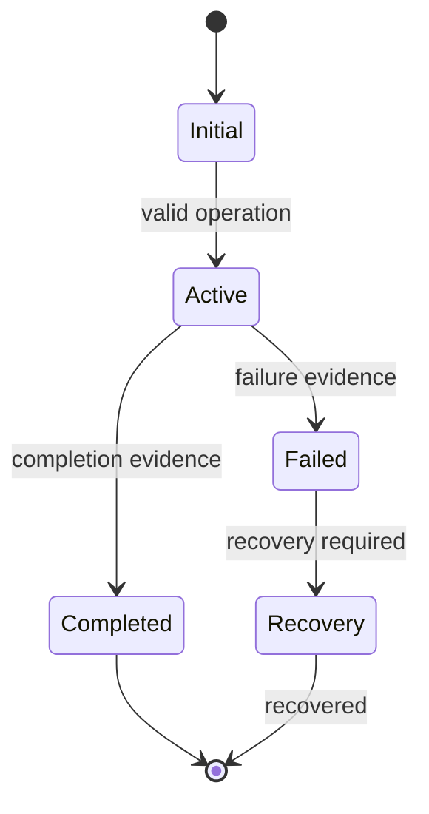

# 安全契约：`<Resource / Component / Operation>`

## 1. Identity

- Contract ID:
- Version:
- Owner component:
- Source files / API:
- Target architectures:
- Related contracts:

## 2. Purpose and scope

- 解决什么问题：
- 包含哪些行为：
- 明确不包含哪些行为：
- 信任边界：

## 3. Types and resources

- Input types:
- Output types:
- Resource identities:
- Ownership model:
- Capability / rights:
- Lease / token:

## 4. Preconditions

列出调用之前必须成立的条件。每项注明由谁建立、谁检查、是否可静态证明。

| ID | Condition | Established by | Enforced by | Evidence |
|---|---|---|---|---|
| PRE-001 | | | | |

## 5. Postconditions

| ID | Result | Resource ownership after operation | Evidence |
|---|---|---|---|
| POST-001 | | | |

## 6. State machine

替换示意状态为实际状态，并列出所有合法/非法转换。

## 7. Operations

| Operation | Requires | Effects | Ensures | Failure behavior |
|---|---|---|---|---|
| | | | | |

## 8. Ownership and aliasing

- 谁拥有资源管理权：
- 谁持有只读/写入/执行权限：
- 是否允许共享引用：
- 是否允许独占访问：
- 权限如何转移或撤销：
- 是否存在异步外部访问：
- `Drop` 是否只是尽力清理：

## 9. Concurrency and memory model

- 线程安全要求：
- 同步机制：
- 原子顺序要求：
- Cache / fence 要求：
- 锁序和死锁假设：
- 并发状态空间与验证范围：

## 10. Failure, timeout, cancellation, recovery

- 错误类型与错误码：
- Timeout 的确切含义：
- Cancel 是否保证底层操作停止：
- 资源何时可以安全回收：
- 崩溃/断电/设备失联后如何恢复：
- 哪些状态必须由内核或硬件确认：

## 11. Platform and hardware assumptions

| Assumption | Platform / device scope | How checked | Fallback |
|---|---|---|---|
| | | | |

## 12. Verification obligations

| Obligation | Property | Method / Tool | Scope and assumptions | Result |
|---|---|---|---|---|
| SAFE-001 | Memory safety | | | |
| SAFE-002 | Ownership correctness | | | |
| SAFE-003 | Permission correctness | | | |
| SAFE-004 | Functional correctness | | | |
| SAFE-005 | Liveness / timing | | | |

## 13. Runtime enforcement

- Kernel checks:
- Capability checks:
- MMU / IOMMU checks:
- Quota / budget checks:
- Fault containment:

## 14. Evidence and status

- Source commit:
- Compiler/toolchain version:
- Tool versions:
- Test results:
- Model-checking results:
- Formal proof references:
- Reviewers:
- Residual risks:

Status: `Draft | Implemented | Tested | PartiallyProved | ProvedUnderAssumptions | HardwareAssured | Unresolved`

## 15. Compatibility mapping

若该契约是对外标准的适配：

- Source standard / ABI / wire protocol:
- Version:
- Mapping: `Equivalent | Refinement | Emulated | Partial | Unsupported`
- Implemented operations:
- Unsupported features:
- Observable semantic differences:
- Error / cancellation differences:
